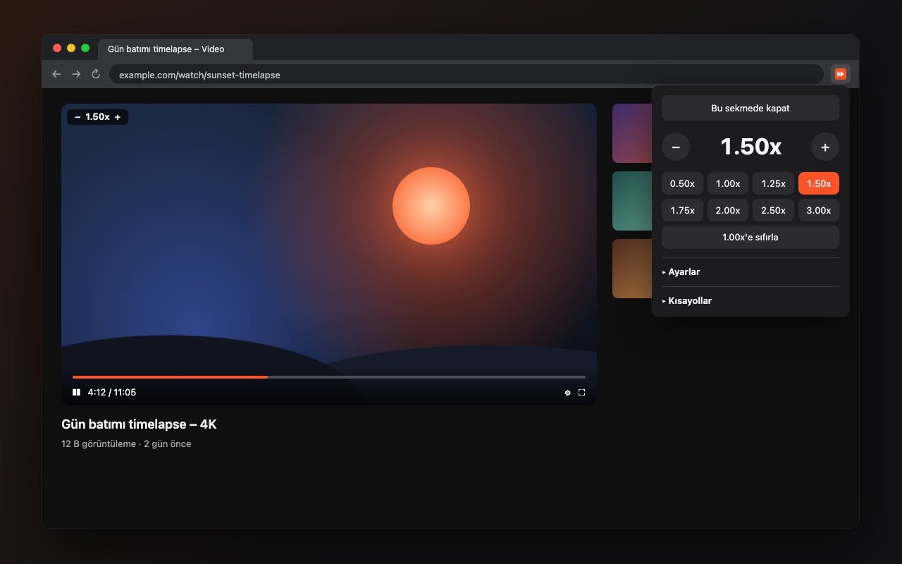

# Speed Controller

Web sayfalarındaki video ve audio oynatma hızını klavye kısayolları, video üstü gösterge ve popup ile kontrol eden Chrome / Brave extension'ı. Yalnızca sizin açtığınız sekmede çalışır.



## Kısayollar

| Tuş | İşlev |
| --- | --- |
| `S` / `D` | Hızı azalt / artır |
| `R` | 1.00x'e sıfırla |
| `G` | 1.00x ↔ tercih edilen hız |
| `Z` / `X` | 10 sn geri / ileri |
| `V` | Hız göstergesini aç/kapat |

## Kurulum (geliştirici modu)

1. `chrome://extensions` (veya `brave://extensions`) → **Developer mode**'u aç.
2. **Load unpacked** → bu klasörü seç.

## Paketleme

```sh
sh scripts/package.sh   # dist/speed-controller-<version>.zip
```

## Gizlilik

Hiçbir veri toplanmaz veya gönderilmez. Bkz. [Gizlilik Politikası](store/privacy-policy.md).
